<div align="center">

# 🖥️ RackWatch
### Server-room temperature & humidity monitoring, alerting, and reporting

**A full-stack monitoring system built with C11, Spring Boot, PostgreSQL, Docker, and vanilla JavaScript.**

[Features](#-what-rackwatch-does) · [Architecture](#-how-it-works) · [Quick start](#-quick-start) · [Screenshots](#-screenshots) · [API](#-api-reference) · [Testing](#-testing)

</div>

---

> **Verified status:** The complete `make test` workflow passed in the supplied development run on 23 November 2026. The OWASP dependency-check Maven stage was skipped, so this is not a claim of a clean dependency vulnerability scan.

## 📌 What is RackWatch?

RackWatch is a server-room environment monitoring system. It collects temperature and relative-humidity readings from configured sensors, sends them to a backend API, stores them in PostgreSQL, evaluates alert rules, and displays the latest state in a browser dashboard.

It demonstrates the complete monitoring workflow: collect readings, ingest JSON batches, store data without duplicates, detect excursions and sensor faults, display room health and history, acknowledge alerts, and export Excel reports.

**Important:** RackWatch currently uses configured/simulated readings. It is not connected to physical sensors by default. It is a student project, not a hardened production monitoring product.

## 🎯 Why this project exists

A server room can become unsafe gradually. Cooling performance may decline, temperature may rise, humidity may move outside its operating range, or a sensor may stop reporting meaningful changes. A single threshold is not enough: one bad reading may be noise, a fast rise can matter before a fixed threshold is crossed, and a sensor stuck at a plausible value can hide a real problem.

## ✨ What RackWatch does

| Capability | Description |
|---|---|
| 🌡️ Temperature monitoring | Tracks configured temperature sensors. |
| 💧 Humidity monitoring | Tracks relative-humidity sensors. |
| 🧩 Room status | Shows each room as `GREEN`, `AMBER`, or `RED`. |
| 🚨 Alert evaluation | Evaluates threshold, rate-of-change, and sensor-health rules. |
| 📦 Batch ingestion | Accepts JSON reading batches through the API. |
| 📴 Offline buffering | The daemon buffers readings when the API is unavailable and retries later. |
| 🧯 Quarantine | Rejected batches can be isolated so they do not block good readings. |
| 📈 History chart | Displays a selected sensor's readings over a chosen time window. |
| 📝 Alert acknowledgement | Lets an operator acknowledge an open alert with a name. |
| 📊 Excel export | Downloads an `.xlsx` workbook with a summary section. |
| 🔐 API-key protection | Protects API routes with the `X-API-Key` header. |
| 🐳 Docker Compose | Runs PostgreSQL, the API, and the daemon together. |

## 🧱 Technology stack

| Layer | Technology | Responsibility |
|---|---|---|
| Sensor daemon | C11, libcurl | Sampling, JSON creation, HTTP delivery, buffering, quarantine |
| Backend | Java 21, Spring Boot 3.4.1 | REST API, validation, business logic, alert evaluation |
| Persistence | PostgreSQL 16, Spring Data JPA, JDBC | Readings, sensors, rooms, alerts, audit records |
| Migrations | Flyway | Versioned database schema and seed data |
| Dashboard | HTML, CSS, vanilla JavaScript | Rooms, alerts, charts, report controls |
| Charting | Chart.js | Historical reading visualization |
| Excel export | Apache POI | `.xlsx` report generation |
| Containers | Docker, Docker Compose | Local multi-service deployment |
| Testing | JUnit, Testcontainers, JaCoCo, C test harness, ASan, UBSan | Unit, integration, sanitizer, coverage checks |

## 🏗️ How it works

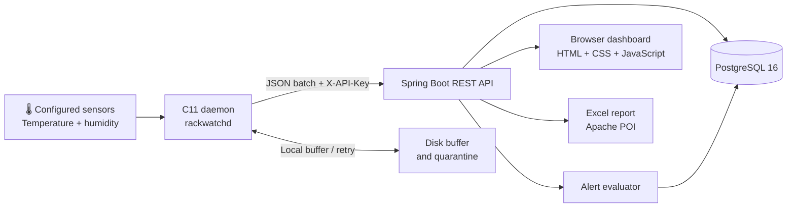

1. **Daemon:** Reads `daemon/sensors.conf`, samples configured sensors, timestamps readings in UTC, and sends JSON batches. If the API is unavailable, readings are buffered and replayed when service returns. Rejected data can be quarantined.
2. **API:** Validates batches, stores readings, evaluates alert conditions, and serves room, alert, history, acknowledgement, and report endpoints.
3. **Database:** PostgreSQL stores monitoring data. Flyway manages schema migrations. A uniqueness constraint prevents duplicate readings for the same sensor/timestamp pair.
4. **Dashboard:** Requests room status, open alerts, and history. It sends the API key in the `X-API-Key` header. It refreshes every five seconds, pauses while the tab is hidden, and backs off after errors.
5. **Excel report:** Exports a bounded date range to `.xlsx`, including a summary section with spreadsheet formulas for minimum, average, and maximum values.

## 🚦 Room status

| Status | Meaning |
|---|---|
| 🟢 `GREEN` | Every configured sensor has a latest reading and it is within configured limits. |
| 🟡 `AMBER` | At least one sensor has no reading yet, and no latest reading is out of range. |
| 🔴 `RED` | At least one sensor's latest reading is outside its configured limits. |

Room status is derived from the latest sensor readings. It is not simply a count of open alerts.

## 🚨 Alert rules

Defaults are configured in `api/src/main/resources/application.yml` under `rackwatch.alerts`. Check that file before relying on or changing a threshold.

| Rule | Trigger | Severity | Notes |
|---|---|---|---|
| `NAIVE_OUT_OF_RANGE` | First out-of-range reading | LOW | Evaluation/replay comparison only; disabled in live ingestion by default. |
| `SMART_THRESHOLD` | Three consecutive out-of-range readings | MEDIUM | Uses a hysteresis clear band to reduce alert flapping. |
| `RATE_OF_CHANGE` | Temperature rises at least 3.0 °C within 10 minutes, held for three readings | HIGH | Detects a rapid rise before a simple threshold rule would. |
| `SENSOR_FAULT` | Thirty identical consecutive readings, or a temperature jump greater than 15.0 °C between readings | HIGH | Jump rule applies to temperature sensors. |

When a sensor fault is currently detected, threshold and rate rules are frozen because the sensor data cannot be trusted. They resume after readings become plausible again.

## 📷 Screenshots

The images are captured from the **running RackWatch application** by the included Playwright script. They are not mockups. Run the script to generate them in `docs/screenshots/`.

| # | File | What it demonstrates |
|---:|---|---|
| 1 | `01-api-key-entry.png` | API-key entry screen. |
| 2 | `02-dashboard-full.png` | Full dashboard after authentication. |
| 3 | `03-rooms-overview.png` | Room cards and current statuses. |
| 4 | `04-room-a-details.png` | First room's sensor readings. |
| 5 | `05-room-b-details.png` | Second room's sensor readings. |
| 6 | `06-open-alerts.png` | Open alerts returned by the API. |
| 7 | `07-alert-acknowledgement.png` | Acknowledgement control with a demo name entered, not submitted. |
| 8 | `08-temperature-chart.png` | Temperature history chart. |
| 9 | `09-humidity-chart.png` | Humidity history chart. |
| 10 | `10-excel-report.png` | Date-range Excel report controls. |
| 11 | `11-mobile-dashboard.png` | Narrow/mobile-width dashboard view. |

#### Screenshot gallery

After running the capture script, GitHub will render these real application screenshots here:

**1. API-key entry** — enter the shared API key before dashboard data is loaded.

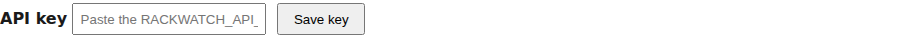

**2. Full dashboard** — overall monitoring interface after authentication.

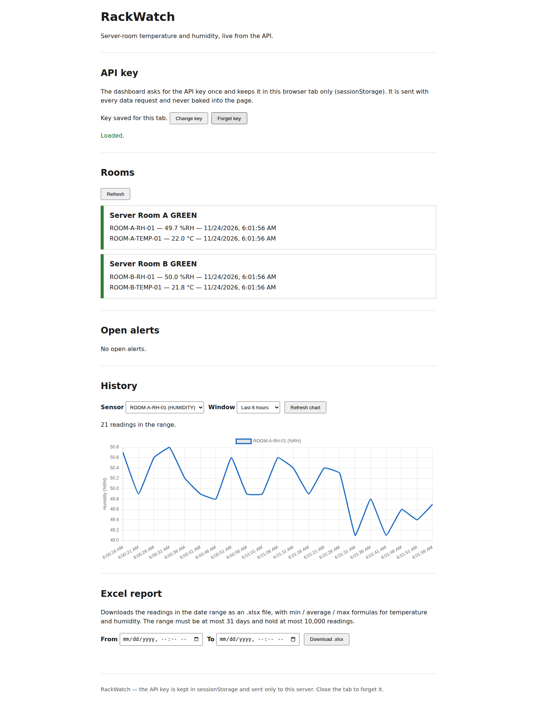

**3. Rooms overview** — room-level status and sensor readings.

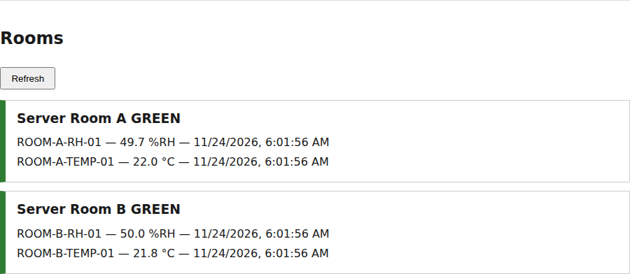

**4. Room A details** — first configured room and its sensors.

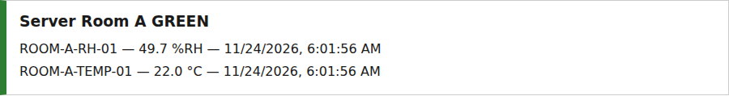

**5. Room B details** — second configured room and its sensors.

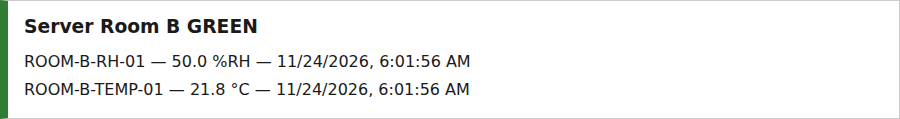

**6. Open alerts** — currently open alerts and their severity.

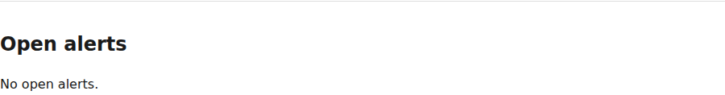

**7. Alert acknowledgement** — acknowledgement input with a sample name; the script does not submit it.


**8. Temperature history** — chart for a configured temperature sensor.

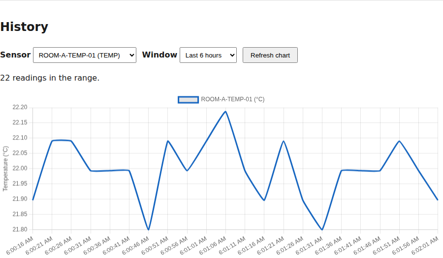

**9. Humidity history** — chart for a configured humidity sensor.

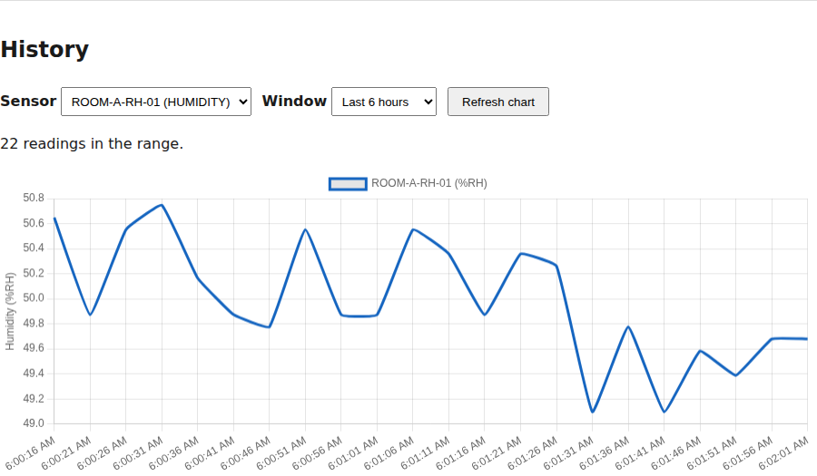

**10. Excel report controls** — choose a date range and request the workbook.

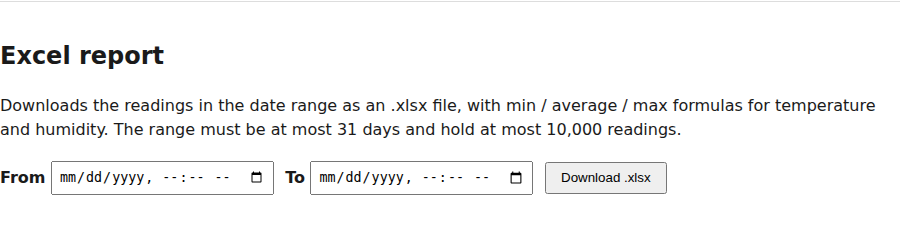

**11. Mobile-width dashboard** — narrow viewport layout.

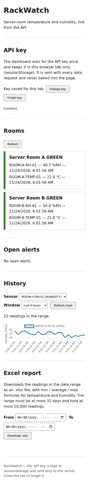

### Generate screenshots automatically

Prerequisites: the full stack is running, the dashboard is reachable, `.env` contains `RACKWATCH_API_KEY`, and the daemon is sending readings for meaningful chart data.

```bash
npm install --save-dev playwright
npx playwright install chromium
node scripts/capture_screenshots.mjs
```

The script reads the API key from `.env`, opens the dashboard, enters the key, waits for live data, and saves PNG files automatically. It does not submit an alert acknowledgement or print the key. For a different port:

```bash
RACKWATCH_BASE_URL=http://localhost:8081 node scripts/capture_screenshots.mjs
```

## ⚡ Quick start

### Prerequisites

- Docker Desktop with WSL2 integration and Docker Compose.
- Internet access for initial image pulls and Maven dependencies.
- Node.js only if you want to generate screenshots.

### 1. Create local secrets

Run from the project root in Ubuntu:

```bash
printf "POSTGRES_PASSWORD=%s\nRACKWATCH_API_KEY=%s\n" \
  "$(openssl rand -hex 16)" \
  "$(openssl rand -hex 32)" > .env
```

`.env` contains secrets. Never commit it or share its contents.

### 2. Start the full stack

```bash
docker compose up -d --build
```

Or use `make up` if you prefer the root Makefile target.

### 3. Check service health

```bash
docker compose ps
curl -fsS http://localhost:8080/actuator/health
```

The health endpoint is public. All `/api/**` routes require the API key.

### 4. Open the dashboard

Open `http://localhost:8080/` and enter the value of `RACKWATCH_API_KEY` from your local `.env` file. The dashboard stores it in `sessionStorage` for the current browser tab.

### 5. Stop the stack

```bash
docker compose down
```

This keeps named volumes. `docker compose down -v` also deletes the local database and daemon-buffer volumes. Use it only when you intend to erase persisted data.

## ⚙️ Configuration

| Setting | Location | Purpose |
|---|---|---|
| Sensor IDs and kinds | `daemon/sensors.conf` | Defines configured sensors. |
| Daemon runtime | Daemon command-line options and `daemon/config.*` | Controls daemon behavior. |
| API key | `.env` → `RACKWATCH_API_KEY` | Shared key for protected API routes. |
| PostgreSQL password | `.env` → `POSTGRES_PASSWORD` | Database credential. |
| Database connection | `docker-compose.yml` and environment | Connects API to PostgreSQL. |
| Temperature/humidity limits | `api/src/main/resources/application.yml` | Environmental limits. |
| Alert parameters | `api/src/main/resources/application.yml` | Thresholds and alert windows. |

Do not put real secrets in source code, screenshots, README examples, or GitHub commits.

## 🔌 API reference

All `/api/**` endpoints require the `X-API-Key` header.

| Method | Endpoint | Purpose |
|---|---|---|
| `POST` | `/api/v1/readings` | Ingest a JSON array of readings. Batch limit: 1–100 items; request body under 64 KB. |
| `GET` | `/api/v1/readings?sensorId&from&to` | Read historical data for a sensor and time range. |
| `GET` | `/api/v1/rooms` | Return rooms, statuses, and each sensor's latest reading. |
| `GET` | `/api/v1/alerts?state=OPEN` | List alerts by state. `OPEN` is the default. |
| `POST` | `/api/v1/alerts/{id}/ack` | Acknowledge an alert. Body: `{"acked_by":"Name"}`. |
| `GET` | `/api/v1/reports/readings.xlsx?from&to` | Download Excel report. Maximum range: 31 days; maximum rows: 10,000. |
| `GET` | `/actuator/health` | Public health check. |
| `GET` | `/` | Load the dashboard. Data requests still require the API key. |

Duplicate `(sensor_id, ts)` readings are not stored twice. Report timestamps are UTC.

### Example: health check

```bash
curl -fsS http://localhost:8080/actuator/health
```

### Example: read rooms

```bash
curl -fsS http://localhost:8080/api/v1/rooms \
  -H "X-API-Key: $RACKWATCH_API_KEY"
```

### Example: read open alerts

```bash
curl -fsS "http://localhost:8080/api/v1/alerts?state=OPEN" \
  -H "X-API-Key: $RACKWATCH_API_KEY"
```

## 🧪 Testing

Run the complete project workflow:

```bash
make test
```

It runs C daemon unit tests, C daemon AddressSanitizer/UBSan tests, daemon integration smoke tests, Spring Boot unit tests, PostgreSQL integration tests through Testcontainers, and JaCoCo coverage checks.

Useful focused commands:

```bash
mvn -f api/pom.xml test                 # API unit tests only
mvn -f api/pom.xml verify               # API unit + integration + coverage
make -C daemon test                     # C daemon unit tests
make -C daemon test-asan                # C daemon sanitizers
make -C daemon test-integration         # daemon smoke test
make report                             # regenerate evaluation report
```

### Latest verified local test run

The supplied run on 23 November 2026 reported:

- C daemon unit tests: 147,335 checks, 0 failures.
- C daemon sanitizer tests: 147,335 checks, 0 failures.
- Daemon integration smoke test: PASS.
- API unit tests: 34 passed.
- API integration tests: 9 passed.
- JaCoCo coverage checks: passed.
- Overall `make test`: completed successfully.

**Dependency scanning caveat:** OWASP dependency-check was skipped in that run. Run the dependency-check workflow with its required NVD API key before claiming a vulnerability scan has passed.

## 📁 Project structure

```text
RackWatch/
├── .github/workflows/          # CI workflows
├── api/
│   ├── Dockerfile
│   ├── pom.xml
│   └── src/
│       ├── main/java/com/rackwatch/
│       │   ├── alert/           # Alert evaluation and ingestion processing
│       │   ├── config/          # Typed application configuration
│       │   ├── model/           # JPA entities
│       │   ├── repository/      # Spring Data repositories
│       │   ├── service/         # Ingestion, room, alert, history, report
│       │   ├── validation/      # Request validation
│       │   ├── web/             # REST controllers and DTOs
│       │   └── security/        # API-key and request security filters
│       └── main/resources/
│           ├── application.yml
│           ├── db/migration/
│           └── static/          # Dashboard HTML, CSS, JS, Chart.js
├── daemon/                      # C11 daemon and tests
├── docs/
│   ├── screenshots/             # Generated UI screenshots
│   └── evaluation.md            # Generated evaluation output, if present
├── scripts/
│   └── capture_screenshots.mjs
├── docker-compose.yml
├── Makefile
├── README.md
└── SECURITY.md
```

## 🔒 Security notes and limitations

RackWatch uses a shared API key for protected API routes. Secrets are supplied through environment variables and should stay in `.env`, which must not be committed. Read [`SECURITY.md`](SECURITY.md) for the security mapping and detailed limitations.

Known limitations:

- This project is not production-hardened.
- Default daemon-to-API communication is HTTP. The API key is not encrypted in transit. Use TLS before deploying across an untrusted network.
- There is one shared API key, not individual user accounts or roles.
- There is no API rate limiting.
- Failed API-key attempts are not recorded as a dedicated audit event.
- Evaluation scenarios are synthetic and author-designed, not real server-room measurements.
- An incident that begins and ends entirely inside a flushed batch may not create an alert because evaluation occurs at the batch's newest timestamp.
- A stable humidity sensor can produce repeated identical rounded values and may trigger the flatline sensor-fault rule.

These limitations are documented rather than hidden. Do not use RackWatch as the only safety system for a real server room.

## 🗺️ Suggested learning path through the code

1. `daemon/sensors.conf` — understand configured sensors.
2. `daemon/reading.c` and related daemon files — follow a reading's lifecycle.
3. `api/src/main/java/com/rackwatch/web/` — inspect API endpoints.
4. `api/src/main/java/com/rackwatch/service/` — follow ingestion and reporting logic.
5. `api/src/main/java/com/rackwatch/alert/` — understand alert rules.
6. `api/src/main/resources/db/migration/` — see database creation.
7. `api/src/main/resources/static/` — explore the dashboard.
8. `docker-compose.yml` — understand how services run together.
9. `api/src/test/` and `daemon/test/` — review verification.

## 🤝 Contributing

For experiments: create a feature branch, make one focused change, run relevant tests, run `make test` before merging, and update documentation when behavior or configuration changes. Never commit `.env`, generated secrets, local database files, or machine-specific paths.

## 📄 License

No license has been specified yet. Until a license is added, do not assume the repository grants permission to reuse, redistribute, or modify the project.

---

<div align="center">**RackWatch — monitor the environment before it becomes an incident.**</div>
